# README.PLUGINS

How the **RedAmon plugin system** works, end to end: the architecture, the design, and
the mechanics of installing, updating and uninstalling a plugin.

This document explains the **platform**, not any individual plugin. It is written for
two audiences:

- **Platform developers** working in this (base) repo, who build and maintain the
  machinery that hosts plugins.
- **Plugin authors** working in the separate **`redamon-plugins`** repo, who need to know
  the contract a plugin must satisfy.

What a specific plugin does (for example the first one, **`skiller`**) is documented in
that plugin's own folder in `redamon-plugins`, never here. This file describes the host;
the plugins are its guests.

> **Status: design / target architecture.** The platform described here does not exist in
> the tree yet. Anything marked *(proposed)* is intended layout, not a current file. Links
> to existing code are real: they are the seams and precedents the platform builds on.
>
> **Diagram convention.** Every diagram sets its own colours on its first line, so it reads
> the same in light and dark themes whatever the viewer's default. When you add a diagram,
> copy that line from an existing one, and wrap sequence-diagram messages in the light
> `rect` panel the others use.

---

## 1. The problem, in one paragraph

RedAmon keeps growing. Every feature ships to everyone who clones the repo, together with
the Docker images and models it brings, whether or not a given user wants it. We want
optional features that stay **out of the base repo entirely**, that an administrator
**downloads and installs on demand**, that are **updated independently of RedAmon
releases**, and whose removal returns the product to exactly its factory behaviour. The
plugin system provides this. It follows the model of VS Code extensions and browser
extensions: a small, stable **platform** lives in the base product, and the features live
outside it and plug in through a fixed, versioned contract.

---

## 2. The core model: two repos and a catalog

There are two repositories and one index that connects them.

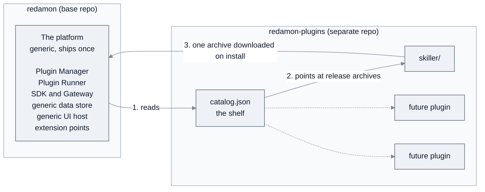

- **`redamon` (this repo)** contains the **platform**: everything needed to *host* plugins.
  It contains **no plugin code** and does not know what any plugin does.
- **`redamon-plugins`** is a **monorepo of plugins**: many plugins side by side (`skiller`
  first, others later) plus a top-level **`catalog.json`** that lists them. Each plugin is
  versioned and released **independently**, even though they share one repo (§6.2).
- **The catalog** is the bridge: a signed JSON index that tells the platform which plugins
  exist, their versions, download URLs, checksums and requested permissions.

Nobody clones `redamon-plugins` to use a plugin. The platform downloads a single plugin's
release archive at install time into a persistent folder, and runs it from there.

### 2.1 The life of a plugin, in one picture

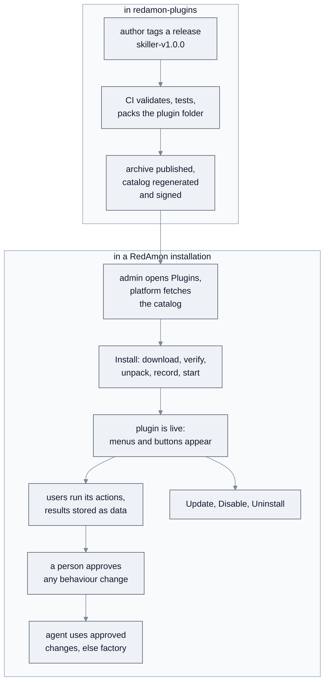

The rest of this document zooms into each box.

---

## 3. Design principles (the invariants)

Everything below exists to preserve six rules. A change that breaks one of them is wrong.

1. **The base product always works without any plugin.** Plugins are purely additive.
   Disable or uninstall every plugin and RedAmon behaves exactly as it does today. The core
   never *waits* on plugin code on a hot path (§8.2).
2. **Plugins contribute only at declared extension points.** A plugin cannot patch
   arbitrary core code; it can only register at named slots the platform deliberately
   opened (§7.6). This is what stops plugins tangling into the core and into each other,
   the problem that motivated the system.
3. **Data, not schema; descriptions, not compiled screens.** Installing a plugin never
   changes the database schema and never rebuilds an image. Plugin state lives in a generic
   store (§7.4); plugin UI is *described* and drawn by a generic host (§7.5).
4. **Plugin code is untrusted and runs isolated.** It runs in a separate **Plugin Runner**
   (§5) with no database credentials, no LLM keys and no internet access, and reaches the
   system only through the **Gateway**, which enforces the permissions an administrator
   approved (§10).
5. **A person approves every change to agent behaviour.** No plugin output changes what
   the agent does until a person has reviewed it as a before/after comparison and approved
   it, in core UI the plugin does not control (§7.6).
6. **The platform API is a public contract.** Once plugins depend on an SDK call, an
   extension point or a UI primitive, it is versioned and cannot change silently (§11).

---

## 4. The platform, at a glance

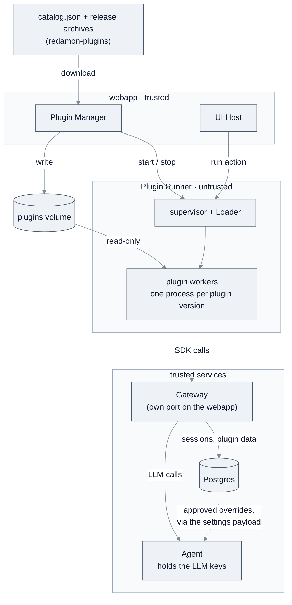

The six platform components (§7) are all **generic**: none contains logic for `skiller` or
any other plugin. The dashed line is the only way plugin output can change core behaviour:
approved overrides are **data** the agent reads at each turn (§8.2). The agent never calls
plugin code.

---

## 5. The Plugin Runner

### 5.1 Why a separate container

The agent is baked into the `redamon-agent` image and sits on the critical path of every
session. Running downloaded third-party code inside that process would let a slow or
crashing plugin take the agent down, and would put plugin code next to the LLM API keys.
So plugin code runs in its **own container, the Plugin Runner**:

- **Isolated failure.** A broken plugin cannot crash the agent or the webapp.
- **Isolated secrets.** The Runner holds no database credentials and no LLM keys. When a
  plugin needs an LLM it asks the Gateway, and the **agent** makes the call with the user's
  key. The agent already has the helper that builds a model for a given user
  ([`_build_llm_with_model_for_user`](../../agentic/api.py#L594)); the platform adds an
  internal endpoint around it *(proposed)*. The key never enters the Runner, which keeps the
  credential boundary RedAmon already enforces.
- **Code loaded at runtime, no rebuild.** Plugin code lives on a persistent volume that the
  Runner reads. The idea extends an existing precedent: community skills are Markdown files
  bind-mounted read-only into the agent and picked up without a rebuild
  ([docker-compose.yml:903](../../docker-compose.yml#L903)). Plugins apply the same idea to
  code, in a container built for it. A new plugin needs **no image rebuild**, as long as it
  only uses libraries the Runner image provides (§11.3).

### 5.2 Inside the Runner: one supervisor, one worker per plugin version

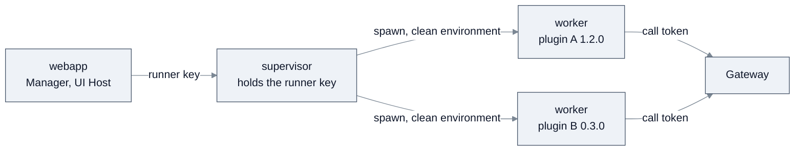

Python cannot reliably unload a module or kill a running thread, and every plugin has a
top-level `engine/` package that would collide in a shared interpreter. So the Runner never
loads plugin code into its own process:

- A **supervisor** process receives requests from the webapp and manages workers.
- Each **(plugin, version)** gets its own **worker subprocess**, with
  `sys.path = [platform SDK, plugin root, plugin vendor folder]`. Two versions of one
  plugin (old and new during an update) are simply two workers.
- **Unload** means terminating the worker, **reload** means starting a new one, and a
  **timeout** means killing it. Each action's timeout is therefore actually enforceable.
- Each worker runs under its **own UID** with memory, CPU and process limits, and starts with
  a **clean environment**. Call tokens arrive with each request, not through the environment.

### 5.3 Authentication

- **Webapp to Runner.** A dedicated `PLUGIN_RUNNER_KEY`, held only by the webapp and the
  supervisor. The check is auth-only and **fails closed**: no key configured means no
  requests accepted. It deliberately does not reuse the agent's
  [`require_internal_auth`](../../agentic/llm_guard.py#L186), which accepts every request when
  no key is set and applies the per-user LLM spending cap. The auth-only shape of
  [`require_internal_auth_only`](../../agentic/llm_guard.py#L249) is the model to follow.
- **Workers to Gateway.** Only the per-call token described in §7.3. Workers never see the
  runner key.

### 5.4 How it runs, and what happens when it is down

The Runner is a normal service of the stack, built and started by `./redamon.sh` like the
others *(proposed)*. It is small, and idle when no plugin is installed. It has container limits
(`mem_limit`, `pids_limit`, `cpus`), as the webapp service does.

**No other service depends on it.** If it is stopped or missing, the stack runs normally:
plugin actions return `503 Runner unavailable`, the Plugins page shows the Runner as down, and
**overrides that were already approved keep applying**, because they are data in Postgres, not
plugin code (§8.2).

---

## 6. Anatomy of a plugin (in `redamon-plugins`)

### 6.1 Repo layout

```
redamon-plugins/
├── catalog.json                 # generated by CI, never hand-edited
├── catalog.json.sig             # detached signature over catalog.json
├── .github/workflows/release.yml
├── skiller/
│   ├── plugin.json              # the manifest: the whole contract with the platform
│   ├── engine/                  # Python actions, executed by a worker
│   ├── vendor/                  # optional bundled pure-Python dependencies
│   ├── ui/                      # screen descriptions (JSON), drawn by the UI host
│   ├── migrations/              # numbered data migrations: 0001_up.py, 0001_down.py, ...
│   ├── tests/
│   ├── CHANGELOG.md
│   └── README.md                # what skiller does is documented HERE, not in base
├── <next-plugin>/
└── <another-plugin>/
```

Each top-level folder is one plugin and is fully self-contained. Plugins never import from
each other; anything two plugins share belongs in the platform SDK. A plugin id must match
`^[a-z][a-z0-9-]{1,39}$` and must not be a reserved name (such as `staging`), because it
becomes a folder name on the plugins volume.

### 6.2 Releases and the catalog

Plugins share a repo but are released one at a time. A release is a git tag of the form
`<pluginId>-v<version>` (for example `skiller-v1.0.0`). For that tag, CI:

1. validates `plugin.json` and every screen description against the platform schemas,
2. runs that plugin's tests against the **lowest** platform version in its declared range,
3. packs **only that plugin's folder** into `<pluginId>-<version>.tar.gz`,
4. computes its SHA-256 and attaches the archive to a GitHub release,
5. regenerates `catalog.json`, increments its `serial`, and writes a detached signature.

Steps 5 for two tags pushed together run in one CI concurrency group, so they never race.
The signing key lives in a protected GitHub environment that needs a reviewer; release tags
are protected, and each plugin folder has its own CODEOWNERS, because one key signs every
plugin in the repo.

```jsonc
{
  "catalogVersion": 1,
  "serial": 42,                             // only ever increases
  "expires": "2026-12-31T00:00:00Z",        // a stale catalog is refused
  "plugins": [
    {
      "id": "skiller",
      "displayName": "Skiller",
      "description": "…",
      "releases": [
        {
          "version": "1.0.0",
          "platform": ">=1.0.0 <2.0.0",
          "dataVersion": 1,
          "url": "https://github.com/<owner>/redamon-plugins/releases/download/skiller-v1.0.0/skiller-1.0.0.tar.gz",
          "sha256": "…",
          "permissions": ["…"]
        }
      ]
    }
  ],
  "revoked": [ { "id": "…", "version": "…", "reason": "…" } ]
}
```

- **Signature.** `catalog.json.sig` is a detached signature over the exact bytes of
  `catalog.json`. The base repo ships a **keyring** of trusted public keys with key IDs, so a
  key can be rotated by publishing the next key in a platform release before it is used.
- **Freshness.** The platform remembers the highest `serial` it has accepted and refuses an
  older catalog, and refuses any catalog past `expires`. This stops an attacker serving an
  old catalog that still lists a since-revoked version.
- **Revocation.** An installed version that appears in `revoked` is disabled automatically
  and the Plugins page shows the reason.
- **Release choice.** The platform installs the newest release whose `platform` range
  includes the running platform version, not simply the newest release.
- **Download hosts.** Archive URLs must be `https` on an allowlisted host (GitHub release
  assets by default), so a catalog entry can never make the webapp fetch an internal address.
- **Consent first.** Permissions are listed per release, so the Plugins page can show the
  consent prompt *before* anything is downloaded.

### 6.3 The manifest (`plugin.json`)

The manifest is the whole contract between a plugin and the platform: identity,
compatibility, permissions and contributions. The example below is a generic illustration,
not a real plugin.

```jsonc
{
  "id": "example-plugin",
  "version": "1.0.0",
  "displayName": "Example Plugin",
  "description": "…",
  "platform": ">=1.0.0 <2.0.0",           // platform API range it targets (§11)
  "dataVersion": 1,                       // shape of its stored data (§9.5)

  "permissions": [                        // approved by the admin at install (§10)
    "session:read",
    "llm:invoke",
    "override:skill.text"
  ],

  "actions": [                            // entry points a worker can execute (§7.7)
    { "id": "run", "entry": "engine/main.py:run", "timeoutSeconds": 120 }
  ],

  "contributes": {                        // extension points it uses (§7.6)
    "nav": { "label": "Example", "icon": "puzzle", "screen": "ui/home.json" },
    "chat.session.actions": [ { "label": "Run example", "action": "run" } ]
  }
}
```

The platform decides what a plugin may do from its manifest alone and never inspects its
Python for that. A capability missing from the manifest is a capability the plugin does not
have. `timeoutSeconds` is capped by a platform maximum.

---

## 7. The platform components

### 7.1 Plugin Manager

The Plugins page and the logic behind it, inside the webapp. It fetches and verifies the
catalog, shows available and installed plugins, displays the consent prompt, and runs the
whole lifecycle of §9, including **reconciliation and crash recovery** (§9.7). It is the
**only writer** of the plugins volume. It is reached from one **Plugins** button in the top
bar ([GlobalHeader.tsx](../../webapp/src/components/layout/GlobalHeader/GlobalHeader.tsx))
and a page under `webapp/src/app/plugins/`.

- **Who can do what.** Installing, updating, enabling, disabling and uninstalling are
  **instance-wide, admin-only** actions, because they put code on the host. The lifecycle
  routes read the admin role from the database on every request
  ([lifecycleRoutes.ts](../../webapp/src/lib/plugins/lifecycleRoutes.ts)), because the role
  inside a login token outlives a demotion by up to seven days. An admin acting as another
  user keeps these rights and is recorded as the actor.
  Every signed-in user sees the contributions of enabled plugins; only admins see the
  management controls.
- **Audit.** Every lifecycle operation, every override proposal, approval and reset, and
  every permission grant is recorded with the existing
  [`writeAudit`](../../webapp/src/lib/audit.ts#L17) into the `AuditLog` table.

**As built (platform 1.0.0).** The modules live in
[`webapp/src/lib/plugins/`](../../webapp/src/lib/plugins/):

- [`fetchRemote.ts`](../../webapp/src/lib/plugins/fetchRemote.ts), the only outbound fetch:
  `https` on port 443, a host in `PLUGINS_DOWNLOAD_HOSTS` on every hop (at most five
  redirects, followed by hand), the address checked by the socket's own DNS lookup and refused
  unless public (so a DNS answer cannot change between the check and the connection), one
  deadline over all hops, and size caps counted while streaming.
- [`keyring.ts`](../../webapp/src/lib/plugins/keyring.ts) and
  [`catalog.ts`](../../webapp/src/lib/plugins/catalog.ts): the official keys (none until the
  production key is published) plus the admin's `PLUGINS_EXTRA_TRUSTED_KEYS`; the signature,
  the schema, the expiry (a warning under 14 days) and the highest serial, kept with the bytes
  of that catalog. A lower serial is a replay (a CDN can lag a push): the stored catalog is
  used and the replay logged.
- [`archive.ts`](../../webapp/src/lib/plugins/archive.ts),
  [`staging.ts`](../../webapp/src/lib/plugins/staging.ts) and
  [`installChecks.ts`](../../webapp/src/lib/plugins/installChecks.ts): a strict ustar reader
  (regular files and directories under one top folder named after the plugin, nothing else,
  at most 2,000 entries and `PLUGIN_ARCHIVE_MAX_BYTES` unpacked), the six checks of §9.3, and
  staging on the volume with fixed modes (files a webapp running as root writes are handed to
  uid 1001).
- [`lifecycle.ts`](../../webapp/src/lib/plugins/lifecycle.ts),
  [`migrations.ts`](../../webapp/src/lib/plugins/migrations.ts),
  [`reconcile.ts`](../../webapp/src/lib/plugins/reconcile.ts) and
  [`exportData.ts`](../../webapp/src/lib/plugins/exportData.ts): §9.
- Routes under `/api/plugins/`: `GET /` and `GET /[pluginId]` for every signed-in user (admins
  also see errors, versions on disk, data usage and the rollback check); for admins
  `POST /[pluginId]/{install,update,rollback,enable,disable,uninstall}`,
  `GET /[pluginId]/{export,logs}` and `POST /offline-install`; and
  `POST /api/internal/plugins/reconcile` for the recon orchestrator. Every one answers 404 while
  the switch is off; a lease conflict is `409 plugin_busy`.
- The page: one card per catalog plugin (and per installed plugin the catalog no longer lists)
  with the actions its state allows, the consent prompt, the uninstall dialog (keep, or export
  then delete everything with the plugin id typed), Install from file, the catalog's state,
  a banner when the runner is down, and for admins a details drawer with the plugin's log.

### 7.2 Loader

The part of the Runner's supervisor that knows which plugins to run. It does not read the
database (the Runner has no credentials): on start, and whenever the Manager tells it, it asks
the Manager for the **run list**, the plugins that are enabled and `ready` with their active
version, and starts or stops workers to match. Every action is then served through one
generic endpoint:

```
POST /plugins/{pluginId}/actions/{actionId}
```

### 7.3 SDK and Gateway

A plugin reaches the outside world only through the SDK, which has two halves:

- **SDK client**: a small Python library the plugin imports, running inside its worker. It
  is only a convenience wrapper over HTTP calls.
- **Gateway**: endpoints on the trusted side that actually serve those calls. **All
  permission checks happen here**, never in the client, so a plugin that skips the SDK and
  makes raw requests gains nothing. The Gateway listens on **its own port** of the webapp
  *(proposed)*, and that is the only port reachable from the plugins network, so a worker
  cannot reach any other webapp route.

Each action invocation carries a short-lived **call token**, minted by the webapp and bound
to `(plugin, acting user, project, session)`. The session is set only when the action was
started from a session, so `sdk.session.read` can read that one session and nothing else.
The Gateway authorizes every call against the token and the plugin's granted permissions.

| SDK call | Permission | What the Gateway does |
|---|---|---|
| `sdk.session.read()` | `session:read` | returns the transcript of the token's session, with credentials masked (see below) |
| `sdk.llm.invoke(messages)` | `llm:invoke` | forwards to the agent, which runs the model the user chose for this plugin |
| `sdk.data.get / put / query / delete` | always granted | reads and writes rows in the plugin's own namespace, within its quota |
| `sdk.override.get(point, target)` | `override:<point>` | returns the factory text of the target, its checksum and the active override, if any |
| `sdk.override.propose(point, target, value, note)` | `override:<point>` | validates the value and stores it as **Proposed** (§7.6) |
| `sdk.override.withdraw(proposalId)` | `override:<point>` | withdraws one of the plugin's own proposals |

Three rules shape these calls:

- **Transcripts are masked, not anonymised.** The Gateway masks credential-shaped values
  (keys, tokens, cookies, private keys) the same way the CypherFix evidence bundle does
  ([`redact_secret_shapes`](../../agentic/cypherfix_triage/evidence.py#L147)). Target
  hostnames, IPs and findings stay readable, because a transcript without them is useless and
  regex anonymisation of free text is not reliable. The consent text for `session:read`
  therefore says plainly that **plugin code sees target data**. That is acceptable because
  plugin code comes only from the signed catalog, runs with no internet access, and cannot
  send data out through the browser (§7.5). The transcript is handed over marked as
  untrusted content.
- **The user picks the model, not the plugin.** Each plugin with `llm:invoke` gets an entry
  in the existing "models by feature" settings
  ([llmFeatures.ts](../../webapp/src/lib/llmFeatures.ts)), where the user chooses its model.
  Plugin LLM calls have their own budget, separate from the user's shared daily cap, and
  usage is attributed to the plugin, so a plugin cannot starve other LLM features.
- **Migrations get a narrower token.** During an update, the new version's data migration
  runs with a token that can only touch the plugin's own data (§9.5).

The SDK package is **owned by the base repo** because it *is* the contract, and is published
with each platform release *(proposed)*. `redamon-plugins` pins a platform version of it for
development and CI.

### 7.4 Generic data store

Three platform-owned tables, created **once** when the platform itself is installed. No plugin
ever adds a table.

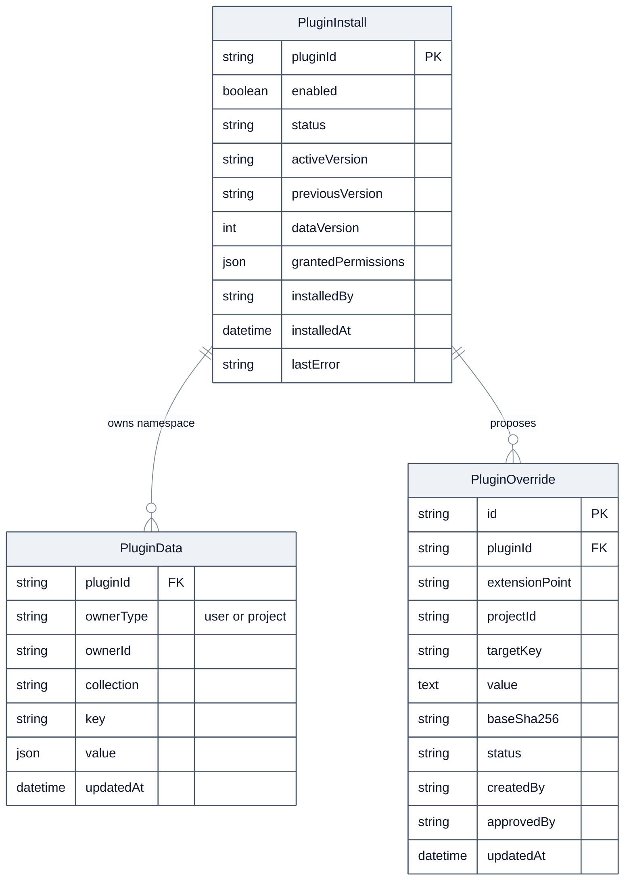

- **`PluginInstall`** is the install registry: one row per plugin on this instance. It holds
  what the admin wants (`enabled`) separately from what the platform observed (`status`,
  §9.1), plus the active and previous versions, the stored `dataVersion` and the permissions
  the admin granted. It is the **source of truth**; the volume and the Runner follow it.
- **`PluginData`** is where plugins keep everything, as JSON, keyed by
  `(pluginId, ownerType, ownerId, collection, key)`. Because every plugin shares this table,
  install never runs a schema migration or regenerates the database client: the property that
  makes install rebuild-free (principle 3). Each plugin has a quota on rows and bytes. When a
  user or project is deleted, its rows are deleted with it.
- **`PluginOverride`** holds values proposed at behaviour extension points, with their
  approval state (§7.6) and the checksum of the factory text they were made against. At most
  one row per `(extensionPoint, projectId, targetKey)` can be **Active**. Rows are deleted
  with their project.

### 7.5 Generic UI host

The webapp is compiled at build time, so a plugin cannot ship real React screens. It ships
**screen descriptions** in JSON, and the host draws them from a fixed set of **UI
primitives** that ship once in base: page, list, table, form, select, button, Markdown view,
before/after text comparison, badge, empty state.

```jsonc
{
  "type": "table",
  "title": "Saved items",
  "source": { "action": "list_items" },              // rows come from a plugin action
  "columns": [ { "field": "name" }, { "field": "updatedAt", "format": "date" } ],
  "rowActions": [ { "label": "Open", "screen": "ui/detail.json", "pass": ["id"] } ]
}
```

Data comes from plugin actions, buttons and forms call plugin actions, and row actions pass
the listed row fields as action input. The host never runs plugin JavaScript.

Plugin content is untrusted, so the host draws it defensively:

- Text is always escaped. The Markdown primitive renders no raw HTML and **no remote
  images**, so a screen cannot leak data to an outside server through the user's browser.
- External links open only through a confirmation page that shows the full address.
- Icons come from a fixed allowlist, and every plugin contribution carries a small plugin
  badge, so a plugin button cannot pass itself off as a core button.
- Plugin pages are served with a Content Security Policy that allows images only from the
  webapp itself, and action routes are protected against cross-site request forgery.

This is the price of principle 3: plugin screens can cover list, detail, form and comparison
flows, but only with the primitives the host provides. A new primitive is a **platform**
change (§11).

### 7.6 Extension points

Extension points are the named slots where a plugin may contribute. There are two kinds.

**UI points**

| Point | What a plugin contributes |
|---|---|
| `nav` | a top-level navigation entry and its screen |
| `chat.session.actions` | a button on a chat session; its action receives that session |
| `project.skills.row` | a control next to each built-in skill in project settings; its action receives the project and skill |

**Behaviour point: `skill.text`**

This is the most sensitive point the platform offers, because it changes the instructions the
agent follows. It is defined precisely:

- **What it targets.** A built-in skill's text is not one string. The agent assembles it from
  several **parts**, and which parts are included depends on project toggles, the tools
  allowed in the current phase, and the Rules of Engagement
  ([`build_builtin_skill_workflow`](../../agentic/prompts/__init__.py#L171)). An override
  therefore targets **one part**: `targetKey = <skillId>/<partId>`. The agent publishes the
  list of parts that can be overridden *(proposed)*. Each entry gives the part's kind
  (**template** or **plain text**), its placeholder names and the SHA-256 of its factory text.
- **Where it applies.** At the exact moment the factory code appends that part, after every
  gate has decided to include it. A project toggle or RoE rule that would leave the part out
  still leaves it out. An override can change wording; it can never switch a part on.
- **How it is validated.** Python's formatting rules live in the agent, so validation runs
  there, behind the master internal key
  ([`require_master_internal_auth`](../../agentic/llm_guard.py#L215)). The Gateway calls it on
  every `propose` *(proposed endpoint)*.
  - *Template parts* are filled from project settings with Python's `str.format`. A value
    must parse with Python's format parser; it must use **exactly the same set** of
    placeholder names as the factory part; and every placeholder must be a plain name, with no
    format spec, conversion, attribute or index access. Literal braces must be written as `{{`
    and `}}`. Plugin authors must know this: a single brace breaks the template.
  - *Plain-text parts* are inserted as they are and never formatted, so braces in them are
    harmless.
  - Every value is capped in length.
- **Approval (principle 5).** A valid proposal is stored as **Proposed** and changes nothing.
  The project's owner, or an admin, sees it in the **core** project settings as a before/after
  comparison against the factory text, with the plugin's note, and approves or rejects it.
  Text a plugin proposes may be shaped by content from the target, which is untrusted; that is
  why no proposal reaches the agent without a person's decision.
- **Staleness.** Each override stores the `baseSha256` of the factory part it was approved
  against. If a base update changes that part, the override becomes **Stale** and the factory
  text is used until a person re-approves it, so a base improvement is never silently hidden.
- **Visibility and reset.** Core project settings show every active override as "changed by
  *plugin*", with a **Reset to factory** button. Reset works even when the plugin is disabled
  or uninstalled, because it is core UI.
- **Conflicts.** Approving a proposal replaces the active override for that target, whichever
  plugin made it. The person approving sees which one is being replaced.

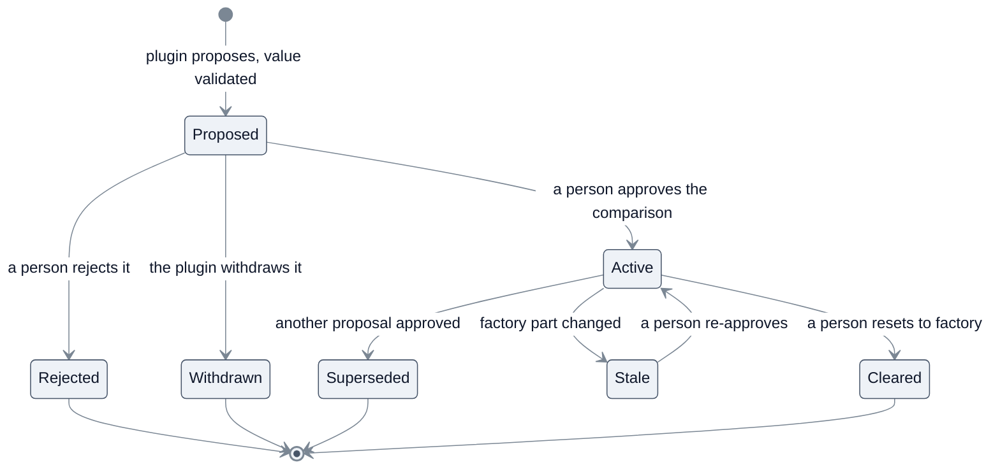

New points are added deliberately, by the platform, when a real plugin needs one. The base
repo still grows, but only in **generic capability**, never in plugin logic.

### 7.7 The action contract

An action is an `async` Python function:

```python
async def run(ctx, params: dict) -> dict:
    ...
```

- **`ctx`** carries the plugin's identity, the acting user, the project, the session when
  there is one, and the SDK client bound to the call token.
- **`params`** is the input from the UI: form fields, the row fields a row action passes, or
  the session and skill context of the extension point that triggered it.
- **The return value** is JSON. Screens bind to it by field name.
- **Errors** are raised as `PluginError(code, message)`. The UI host shows the message; any
  other exception is reported as an internal plugin error, with details only in the plugin's
  log.
- **Long work.** An action declared with `"async": true` returns at once with a job id. The
  Gateway keeps the job's state in the plugin's own data, so it survives a Runner restart.
  The UI polls it and can cancel it, the same start-and-poll pattern the webapp already uses
  for long scans.

The full reference for `ctx`, the screen-description schema and local development lives in
the SDK reference (§13), not here.

---

## 8. Runtime: how an installed plugin participates

There are two paths, and they are designed differently on purpose.

### 8.1 The action path: user-triggered, may be slow

A user clicks a plugin button, the plugin runs, and it usually **leaves its result as data**.
This can take seconds (for example when it calls an LLM). That is acceptable because a person
started it and no core process is waiting on it.

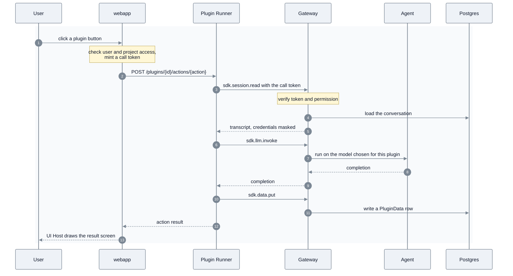

If the Runner is down, step 3 fails fast with `503 Runner unavailable` and the UI says so.

### 8.2 The behaviour path: core-triggered, must never block

This path protects principle 1. When the agent assembles a built-in skill, it **does not call
any plugin**. Approved overrides reach it as data, and anything unexpected falls back to the
factory text.

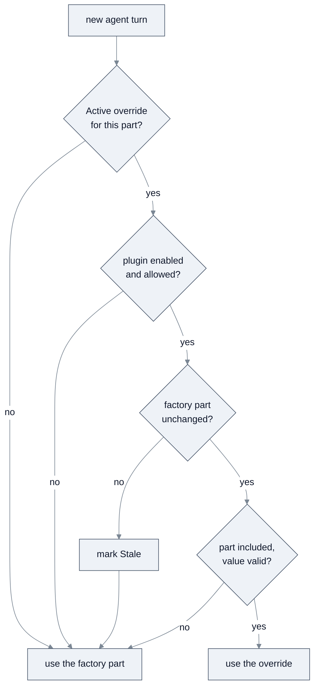

The first three questions are answered by the webapp while it builds the settings payload;
the last one by the agent while it assembles the prompt. "Allowed" means the plugin's status
is `ready` or `updating` and its `override:skill.text` permission is still granted (§9.1).
"Part included" means the factory gates (project toggles, phase tools, Rules of Engagement)
chose to include this part on this turn.

In practice:

- **Overrides arrive with the settings.** The agent reloads project settings from the webapp
  at the start of **every turn**, meaning every message and every resume
  ([`_apply_project_settings`](../../agentic/orchestrator.py#L206), called from each entry
  point). Applicable overrides come in that same payload, so the lookup is in memory. This
  mirrors how enabled user skills are resolved to their stored text today
  ([`get_enabled_user_skills`](../../agentic/project_settings.py#L967)).
- **Changes take effect at the next turn** of every session, including sessions already open.
  A turn already running keeps the snapshot it started with.
- **A failure never breaks the settings.** If settings cannot be fetched at all, the agent falls
  back to defaults with an empty target scope. So the webapp computes overrides in their own
  `try/catch` and leaves them out on any error. Overrides are included only for the agent's
  master key, never for other internal callers of the settings endpoint.
- **One small seam.** Inside `build_builtin_skill_workflow`, at each point where a part is
  appended, the agent checks for an override of that part, re-validates it, and uses the
  factory text on any doubt. With no overrides it does nothing. A failed check logs a warning
  and never raises into the session. Every caller of the builder gets the same behaviour.

The plugin did its work earlier, on the action path, and a person approved the result. The hot
path only **reads data**. If the plugin is disabled, uninstalled, incompatible or broken, its
overrides stop qualifying and the agent uses factory text. **The agent never waits on plugin
code.**

---

## 9. The lifecycle, in depth

### 9.1 Two fields: `enabled` and `status`

`PluginInstall` keeps what the admin **wants** separate from what the platform **observed**,
so neither overwrites the other:

- **`enabled`** (true or false) is set only by an admin.
- **`status`** is set only by the platform, following this machine:

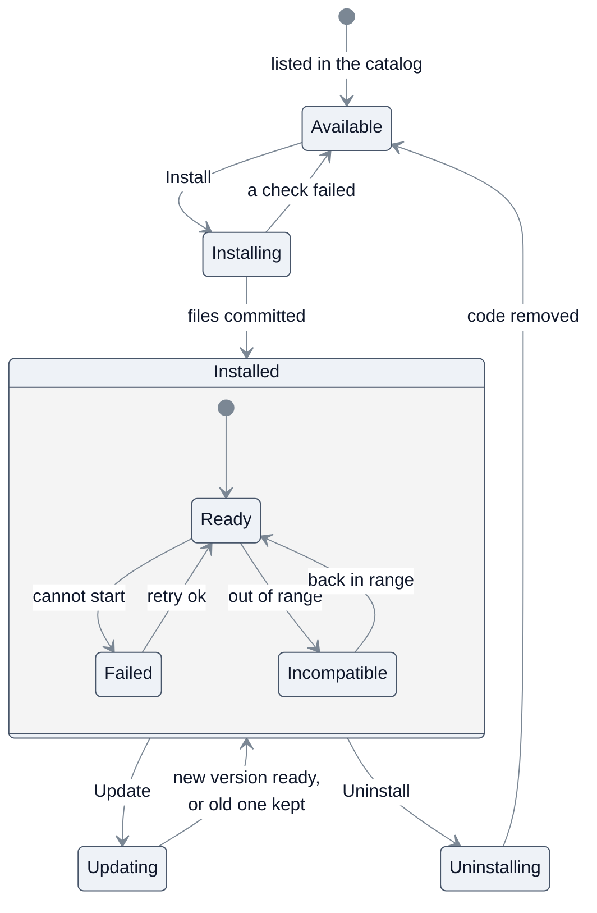

What each combination means:

| `status` | Actions served | UI contributions shown | Overrides apply |
|---|---|---|---|
| `ready`, `enabled` | yes | yes | yes |
| `ready`, not `enabled` | no | no | no |
| `updating` | no (paused) | yes, marked "updating" | yes, if `enabled` |
| `failed`, `incompatible` | no | no | no |
| `installing`, `uninstalling`, `available` | no | no | no |

Overrides keep applying during an update because they are approved data, not plugin code.
Every state change is a **compare-and-swap** on `status`
(`UPDATE … WHERE pluginId = $1 AND status = $expected`). If no row matches, another
operation is in progress and the request is refused, so two admins can never race the same
plugin.

### 9.2 Layout of the plugins volume

```
plugins/                          # persistent volume: Manager read-write, Runner read-only
├── .staging/
│   └── <operationId>/            # one folder per operation; never loaded
└── <pluginId>/
    └── versions/
        ├── 1.0.0/                # previous version, kept for rollback
        └── 1.1.0/                # active version (PluginInstall.activeVersion)
```

- **Staging is per operation**, so concurrent installs of different plugins never share a
  folder.
- **Staging is on the same volume** as the version folders, so moving a version into place is
  a single atomic `rename`.
- **The active version is recorded in the database**, not with a symlink, so the registry
  stays the single source of truth.
- Files are written world-readable and owned by the Manager, so workers can read them and
  cannot change them.

### 9.3 Install, step by step

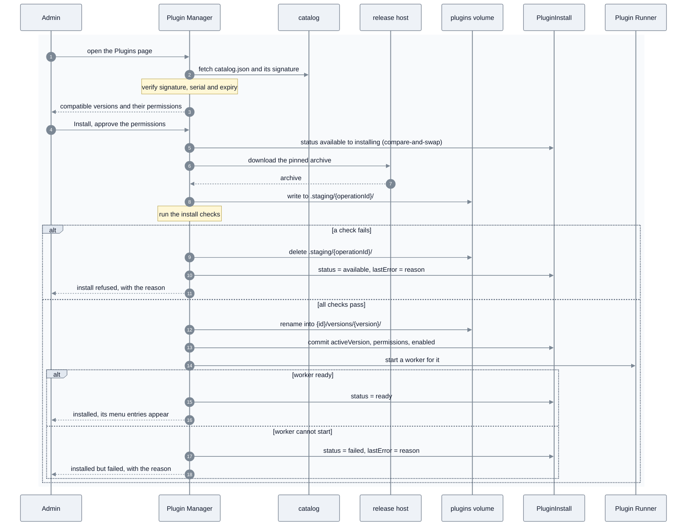

**The install checks**, all of which must pass before anything leaves staging:

1. The archive's SHA-256 matches the entry in the signed catalog.
2. The archive is safe to unpack: no absolute paths, no `..` components, no symlinks or hard
   links, and total size under the platform limit.
3. The `plugin.json` inside matches the catalog entry: same `id`, `version`, `platform` range,
   `dataVersion` and permissions.
4. The manifest and every screen description validate against the platform schemas.
5. The `platform` range includes the running platform version.
6. Every extension point and UI primitive the plugin references exists on this platform.

**Where the commit happens.** Moving the folder into `versions/` and writing the database row
are two steps. The **database write is the commit**: until it succeeds, the Runner, the UI and
the agent ignore the folder. If the process dies between the two steps, reconciliation finds a
folder no row references and deletes it (§9.7). The only trace a refused install leaves is the
`lastError` on its row, shown on the Plugins page.

Install is **rebuild-free**: it copies files onto a volume, writes rows and starts a process.
Nothing is compiled and no schema changes.

### 9.4 Enable and disable

Disabling sets `enabled = false`. The Manager tells the Loader to stop the plugin's workers,
the UI host hides its contributions, and its overrides stop qualifying from the **next agent
turn** (§8.2). **Code and data stay**, so enabling again is instant and loses nothing. Enabling
checks the platform range first and starts the worker; if the worker cannot start, the status
becomes `failed`. Disabling is the safe off switch when a plugin misbehaves, and a disabled
plugin can still be updated.

### 9.5 Update, migration and rollback

Updates install **side by side**, never in place, so the old version keeps working until the
new one is proven.

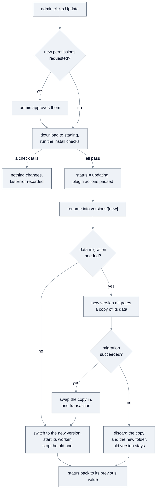

**Migrations.**

- Migrations are numbered files in the plugin's `migrations/` folder. Each moves the data up
  one `dataVersion`, and may have a matching down migration.
- While a migration runs, the plugin's actions are **paused**, so nothing writes the data
  being migrated.
- The migration runs in the new version's worker with a **migration token**. That token can
  only read and write the plugin's own data, and it writes into a **copy** in a staging
  namespace. On success the Gateway swaps the copy in with one database transaction. On
  failure the copy is thrown away. Either way the data is never half-migrated.

**Rollback** makes the previous version active again:

- **No data migration in the update:** the switch is immediate.
- **Data migrated forward:** the new version's down migrations run first, the same
  copy-and-swap way, back to the previous `dataVersion`.
- **No down migration:** rollback is refused, and the Update screen warns about this before
  the admin confirms.

The platform never runs old code on data in a newer shape.

Only the active and previous versions are kept on disk.

This is the main benefit of the two-repo model: a plugin improves by publishing a new release
in `redamon-plugins`, admins update from the Plugins page, and **no RedAmon release is
involved**.

### 9.6 Uninstall and reinstall

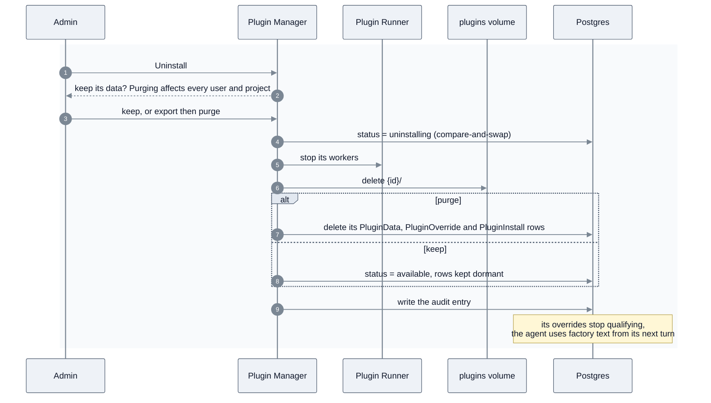

- **Uninstall removes the code** from the volume, so the plugin is again absent from the host.
- **Purge is instance-wide.** It deletes the plugin's data and overrides for **every** user and
  project, so the dialog says so and offers a JSON export first.
- **Keeping data** leaves the `PluginInstall` row in `available`, with its `PluginData` and
  `PluginOverride` rows dormant. Nothing reads data from a plugin that is not installed.
- **Reinstall** goes through the normal install (§9.3). It finds the existing row and data and
  runs data migrations if the stored `dataVersion` is older. It then **asks the admin** whether
  to restore the plugin's previous overrides. Restored overrides whose factory part has changed
  come back as Stale and need a person's approval again.
- **Factory fallback is automatic.** The core only ever *read* the plugin's approved data, so
  once the plugin is not installed those reads stop qualifying and the product behaves as it
  does from the factory. Nothing in the core needs to be undone.

### 9.7 Reconciliation and recovery

The registry is the source of truth, and the **Manager** owns keeping the world in line with
it, because only the Manager can read the database and write the volume. It reconciles when
the webapp starts and on a periodic timer:

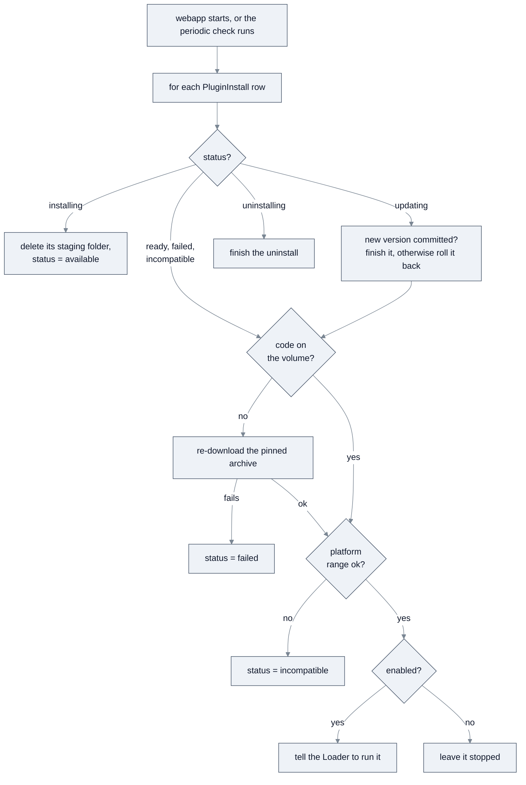

- **Crash recovery.** A crash in the middle of an operation leaves a row in `installing`,
  `updating` or `uninstalling`. The first reconciliation after restart rolls back the install,
  finishes or rolls back the update, or finishes the uninstall.
- **Clean-up.** After the loop, the Manager deletes any version or staging folder that no
  row references, such as a folder left behind by a crash just before its database commit.
- **Base updates.** The plugins volume and the plugin tables live outside the images, so
  `./redamon.sh update` and image rebuilds do not touch installed plugins. If a base update
  moves the platform outside a plugin's `platform` range, the plugin becomes `incompatible`:
  it is inert, its overrides stop qualifying, and the Plugins page explains why. It becomes
  `ready` again when the base moves back into range or an admin installs a compatible release.
- **A lost volume** heals from the catalog, because the checksum pins the exact archive. If the
  release is gone or the host is offline, the plugin becomes `failed` with the reason.
- **Offline installs.** An admin can upload an archive by hand, together with a catalog and
  signature that cover it. It goes through exactly the same checks as a download.
- **The Runner's view.** When the Runner starts, its Loader asks the Manager for the run list
  (§7.2), so a Runner restart never needs database access.

**As built.** The recon orchestrator asks for a reconcile every `PLUGIN_RECONCILE_INTERVAL`
(300 s by default), in the background of its reaper so a slow webapp never delays it, and only
while `PLUGINS_ENABLED` is on (TD-20).

- **One reconcile at a time**, under a platform-wide lease; a second answers `skipped: busy`.
  Each run does bounded work: at most one heal download and a 20-second budget.
- **An operation is recovered only once its lease has expired** (ten minutes), and is claimed
  first, so a slow request and a reconcile never work on one plugin together. An interrupted
  install goes back to available; an interrupted update or rollback is finished when its
  target version is on the volume and moves no data, and undone otherwise (the database write
  is the commit, and a migrating update switches version and data in one transaction); an
  interrupted uninstall is finished, honouring a purge.
- **Clean-up** removes version and staging folders nothing references, never one younger
  than 15 minutes (an install may not have written its row yet).
- **Revocation** sets `revokedReason` from a catalog that verified, never `enabled`, and
  clears it when the catalog lifts it. **Stale versions**: every active skill version is
  compared with the agent's part registry; a removed part or a changed factory text makes the
  whole version stale. When the agent cannot be asked, nothing is guessed.
- A failed plugin is retried; expired data rows are deleted; a job past its deadline is
  failed with `timeout`.

---

## 10. Trust and security model

Plugin code is downloaded from another repository and executed inside a security tool, so the
trust boundaries are explicit.

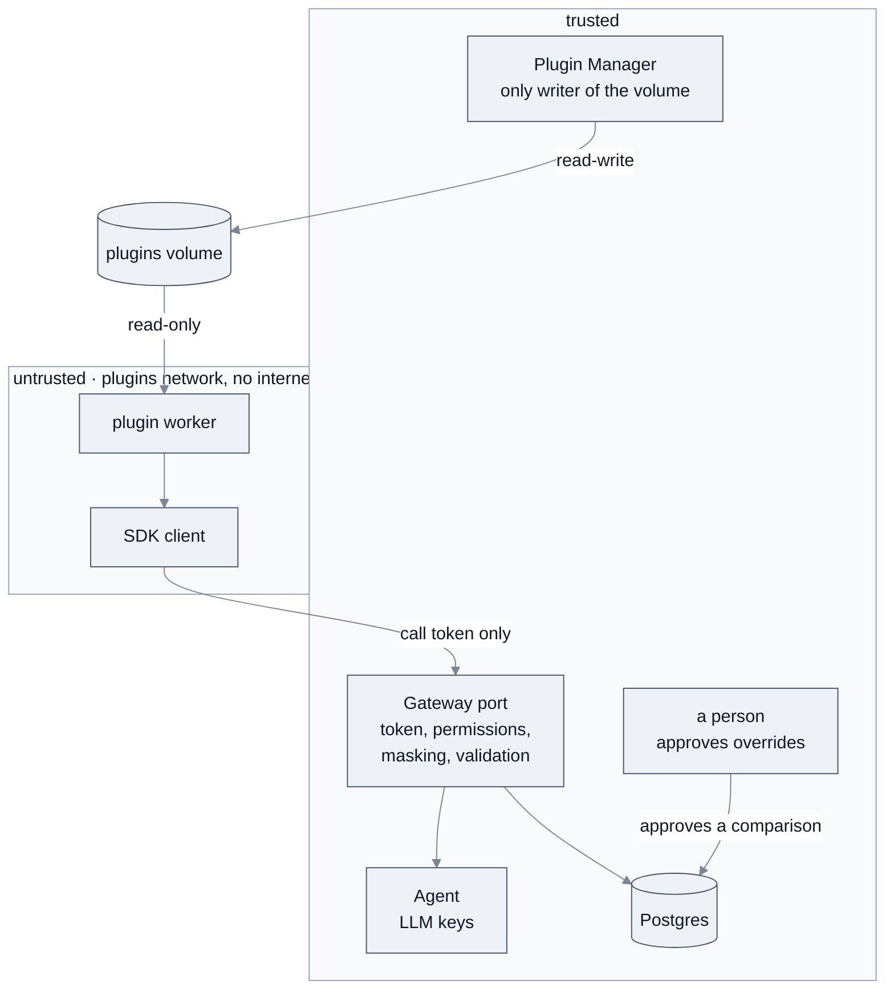

| Threat | Control |
|---|---|
| A tampered archive | SHA-256 from the signed catalog; signature checked against the keyring in the base repo |
| An old catalog that hides a revocation | catalog `serial` must not go backwards; `expires` must not have passed |
| A catalog entry that points the webapp at an internal address | archive URLs must be `https` on an allowlisted host |
| An archive that writes outside its folder | unpack rejects absolute paths, `..`, links and oversize archives |
| A plugin that skips the SDK | permissions are enforced in the Gateway, not in the SDK client |
| A plugin that reads secrets | workers get a clean environment, their own UID, and only per-call tokens; no DB credentials, LLM keys or runner key |
| A plugin that reads another user's data | every call token is bound to (plugin, acting user, project, session) and checked on every call |
| A plugin that reaches other webapp routes | the plugins network can reach only the Gateway port |
| A plugin that sends data out of the host | the plugins network has no internet egress; screens cannot load remote images and run under a strict Content Security Policy |
| A plugin that spoofs core UI | plugin contributions always carry a plugin badge; icons come from an allowlist |
| A plugin that changes how the agent behaves | proposals change nothing until a person approves them in core UI; every active override is visible and resettable |
| An override that breaks or hides factory text | validated on propose and again on read; Stale when its factory part changes |
| A plugin that modifies its own code or another plugin's | the volume is read-only to workers; only the Manager writes it |
| A plugin that crashes, hangs or floods | per-worker kill on timeout, memory, CPU and process limits, concurrency caps, data quotas, a separate LLM budget |
| An update that quietly asks for more access | new permissions require the admin to approve again |
| A malicious catalog | only the official `redamon-plugins` catalog by default; a custom catalog is an explicit admin opt-in with a warning |
| Actions that leave no trace | every lifecycle operation and override decision is written to the audit log |

**Why approval matters so much.** RedAmon's scope guardrail is itself part of the agent's
instructions
([think_node.py:566](../../agentic/orchestrator_helpers/nodes/think_node.py#L566)), and
the instructions are what `skill.text` changes. So an override is the most powerful thing a
plugin can produce, and its consent text says so plainly: it can rewrite the instructions the
agent follows. The platform treats every proposal as untrusted input until a person approves
it (principle 5).

**Known limits of the first platform version.**

- All plugins share one Runner container and are separated by process and UID, not by
  container. If stronger isolation is needed, the next step is one container per plugin. That
  changes nothing in the plugin contract.
- Plugin code sees target data in the transcripts it is allowed to read (§7.3). Its
  containment relies on the trusted catalog and the absence of any way out, not on
  anonymisation.

---

## 11. Versioning and the platform contract

### 11.1 Three version lines

- **Platform version** (semver): the version of the SDK, the Gateway API, the extension points,
  the UI primitives and the manifest and screen schemas that base RedAmon exposes. This is a
  **public API**.
- **Plugin version** (semver): each plugin's own release line in `redamon-plugins`, which
  declares the `platform` range it supports.
- **Plugin data version** (an integer): the shape of a plugin's rows in `PluginData`, stored in
  `PluginInstall.dataVersion` and moved by the plugin's numbered migrations (§9.5).

The rules:

- **Adding** an SDK call, an extension point, a UI primitive or an optional manifest field is a
  **minor** platform bump, compatible with existing plugins.
- **Changing or removing** any of them is a **major** bump. Every plugin targeting the old major
  becomes `incompatible` until it publishes a new release (§9.7).
- A plugin may only use what its declared `platform` range guarantees. The Manager enforces
  this at install, at update and at every reconciliation.

### 11.2 Where the platform version lives

The platform version is a single constant in the base repo *(proposed)*, exposed by the
webapp. The Runner image reports the platform version it was built with. If the two differ,
for example after a partial rebuild, the Manager marks the Runner as out of date and starts no
workers until they match. All range checks use one semver evaluator, in the webapp.

### 11.3 Libraries available to plugins

The Python version (3.11) and the libraries installed in the Runner image are **part of the
platform contract** and are listed in the platform release notes. A plugin may bundle small
pure-Python dependencies in its `vendor/` folder. Anything that needs a compiled or system
library requires a new Runner image, which is a platform release.

### 11.4 Growing the platform

When a plugin needs something the platform does not offer, such as a new UI primitive or a new
extension point, the platform grows **generically** first and ships it in a minor release. Then
the plugin is released against that minor. The base repo gains capability; it never absorbs a
plugin's feature code.

---

## 12. What ships where

| Concern | Base repo (`redamon`): the platform, ships once | Plugin repo (`redamon-plugins`): per plugin |
|---|---|---|
| Hosting | Plugin Manager, Runner (supervisor, Loader, workers) | — |
| Contract | SDK client, Gateway, manifest and screen schemas | depends on a pinned platform version |
| Storage | `PluginInstall`, `PluginData`, `PluginOverride` tables | rows in its own namespace |
| UI | UI host, primitives, extension slots, override review screens | screen descriptions (JSON) |
| Behaviour | generic seams at behaviour points, inert when empty | `sdk.override.propose` calls |
| Distribution | catalog fetch, keyring, signature and checksum checks | catalog generation, signed releases |
| Feature logic | **none** | all of it (`engine/`) |
| Feature documentation | **none** | the plugin's own `README.md` |

The one-time cost in the base repo is the components of §7, the three tables, and the seams of
§8.2. After that, `skiller` and every plugin after it adds **no plugin-specific code** to the
base repo. The base repo grows only when the platform itself gains a generic capability.

---

## 13. Not covered here

This document fixes the architecture. These belong in the **SDK reference** *(proposed)*,
written alongside the first platform release:

- The full `ctx` object, the screen-description schema, and the binding rules for every UI
  primitive.
- How the SDK is distributed (a wheel attached to each platform release, or a package index).
- Local development: a dev mode that loads a plugin folder directly, an SDK fake for tests, and
  a CLI that validates a manifest and its screens before release.
- The implementation of the Gateway's separate port inside the webapp container.
- Where plugin logs are written and how admins read them.

---

## 14. Glossary

- **Platform**: the generic plugin-hosting machinery in the base repo. It knows nothing about
  any specific plugin.
- **Platform version / range**: the version of the platform API; a plugin declares the range
  of platform versions it supports.
- **Plugin**: an optional feature that lives in `redamon-plugins` and is installed on demand.
- **Catalog**: the signed `catalog.json` in `redamon-plugins`, listing plugins and their
  releases.
- **Manifest**: a plugin's `plugin.json`, its full contract (identity, compatibility,
  permissions, contributions).
- **Plugin Manager**: the webapp component that runs the lifecycle and reconciliation, and is
  the only writer of the plugins volume.
- **Plugin Runner**: the isolated container that runs plugin code. It holds no database
  credentials or LLM keys.
- **Supervisor / Loader**: the Runner's main process, which takes requests from the webapp and
  starts and stops workers from the Manager's run list.
- **Worker**: one process running one version of one plugin.
- **Staging**: the per-operation folder where downloads land before they are checked.
- **SDK client / Gateway**: the library a plugin calls, and the trusted endpoints that serve it
  and enforce permissions.
- **Call token**: a short-lived credential for one action invocation, bound to (plugin, user,
  project, session).
- **Namespace**: the set of `PluginData` rows that belong to one plugin.
- **Data version**: the integer shape version of a plugin's stored data.
- **Extension point**: a named UI or behaviour slot where a plugin may contribute.
- **UI primitive / screen description**: a building block the UI host can draw, and the JSON a
  plugin uses to arrange primitives into a screen.
- **Part**: one of the pieces a built-in skill's text is assembled from; the unit a `skill.text`
  override targets.
- **Factory text**: the text a part has in the base repo, used whenever no approved override
  qualifies.
- **Override**: a value a plugin proposes at a behaviour extension point. It changes nothing
  until a person approves it.
- **Stale**: an approved override whose factory part has changed since approval.
- **Incompatible**: an installed plugin whose platform range no longer includes the running
  platform.
- **Action path**: user-triggered plugin work. It may be slow and writes its results as data.
- **Behaviour path**: the agent's use of approved override data at each turn. It never blocks
  and always falls back to factory text.
- **Factory behaviour**: how RedAmon behaves with no plugin enabled, the guaranteed fallback.
